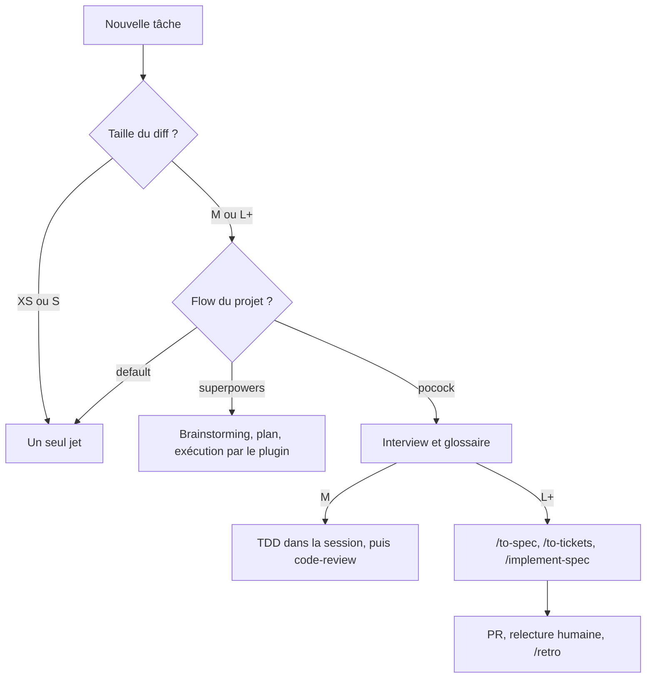

# Flows de travail

Trois façons de travailler cohabitent, et chaque projet en choisit une. Le choix
porte sur le projet, pas sur la tâche : c'est le soin que Cyril veut y mettre.

| Flow          | Intention                         | Ce que Cyril tape                      | Coût en tokens |
| ------------- | --------------------------------- | -------------------------------------- | -------------- |
| `default`     | aller au résultat, projet jetable | rien                                   | le plus bas    |
| `superpowers` | que ça se gère tout seul          | rien, le plugin se déclenche           | moyen à élevé  |
| `pocock`      | poser de bonnes fondations        | trois commandes sur les grosses tâches | le plus élevé  |

## Déclarer le flow d'un projet

Dans le projet, lancer `/flow default`, `/flow superpowers` ou `/flow pocock`.
Le skill écrit une ligne dans `AGENTS.md` (ou `CLAUDE.md`) :

```
Flow : pocock
```

Un projet sans cette ligne est en `default`. Pour changer, relancer `/flow` : la
ligne est remplacée. Les traces de l'ancien flow restent dans le dépôt
(`docs/superpowers/`, `GLOSSARY.md`, issues) ; les supprimer est un choix à part.

## Ce qui est commun aux trois

- L'agent estime la taille du diff après un premier regard au code et l'annonce
  en une phrase.
- XS (quelques lignes) et S (un comportement, quelques fichiers) : un seul jet,
  quel que soit le flow.
- Le flow ne joue qu'à partir de M (plusieurs fichiers ou un choix de conception)
  et de L+ (plusieurs sessions).
- Fini veut dire prouvé par une exécution. Commit et push se font sur demande.



## Flow `default`

Pour un projet jetable ou un essai.

1. Décrire le besoin.
2. L'agent construit en un seul jet, sans cadrage ni sous-agent, même si la tâche
   est grosse. Une tâche L+ est signalée en une phrase, puis il avance.
3. Il relit lui-même son diff et prouve que ça tourne.

Rien n'est créé dans le dépôt en dehors du code.

## Flow `superpowers`

Pour un projet où l'on veut un cadre sans avoir à le piloter. Le plugin
Superpowers se déclenche seul à chaque étape.

1. **Cadrage** : `brainstorming` détoure le sujet et écrit une spec, relue par un
   sous-agent avant d'être rendue.
2. **Plan** : `writing-plans` écrit un plan très détaillé (fichiers, noms,
   signatures, tests de chaque tâche).
3. **Exécution** : `subagent-driven-development` (un sous-agent neuf par tâche,
   une revue après chacune) ou `executing-plans` (tout dans la session, une
   seule revue à la fin, moins cher). L'exécution ne s'arrête pas pour demander.
4. **Fin** : `finishing-a-development-branch` vérifie les tests et propose de
   fusionner, d'ouvrir une PR, de garder la branche ou de la jeter.

| Trace | Emplacement                                             |
| ----- | ------------------------------------------------------- |
| Spec  | `docs/superpowers/specs/AAAA-MM-JJ-<sujet>-design.md`   |
| Plan  | `docs/superpowers/plans/AAAA-MM-JJ-<fonctionnalité>.md` |

Les tâches avancent l'une après l'autre. Il n'y a ni glossaire ni rétrospective.

## Flow `pocock`

Pour un projet à mettre sur de bons rails dès le début. C'est le flow des skills
de Matt Pocock, avec trois aménagements propres à ce dépôt : l'interview se lance
toute seule, le skill `github-tracker` remplace la préparation par dépôt, et
pour une tâche M l'agent construit lui-même en TDD au lieu d'attendre
`/implement`.

### Une fois par projet

- `/flow pocock`.
- `/setup-matt-pocock-skills` seulement si le projet n'utilise pas GitHub Issues
  avec les labels canoniques.

### À chaque tâche M ou L+

| Étape                    | Qui lance                      | Ce qui se passe                                                                                                                            | Ce qui reste                  |
| ------------------------ | ------------------------------ | ------------------------------------------------------------------------------------------------------------------------------------------ | ----------------------------- |
| 1. Décrire               | Cyril                          | expliquer le pourquoi, pas la solution                                                                                                     | rien                          |
| 2. Cadrer                | l'agent                        | `grilling` : des tours de questions numérotées, chacune avec une réponse recommandée ; `domain-modeling` : le vocabulaire et les décisions | `GLOSSARY.md`, `docs/adr/`    |
| 3. Prototyper, si besoin | Cyril ou l'agent : `prototype` | du code jetable pour trancher une question qui ne se règle pas en discutant                                                                | un dossier de prototype       |
| 4a. Construire, tâche M  | l'agent                        | TDD dans la session, puis `code-review`                                                                                                    | le code, les tests            |
| 4b. Spécifier, tâche L+  | Cyril : `/to-spec`             | la conversation devient une spec                                                                                                           | une issue `ready-for-agent`   |
| 5. Découper              | Cyril : `/to-tickets`          | des tranches verticales, chacune avec ce qui la bloque                                                                                     | des sous-issues               |
| 6. Construire            | Cyril : `/implement-spec`      | un sous-agent par ticket débloqué, en parallèle, chacun dans son worktree ; fusion sur une branche d'intégration ; `code-review` final     | une PR                        |
| 7. Relire                | Cyril                          | relecture humaine de la PR                                                                                                                 | des commentaires              |
| 8. Améliorer             | Cyril : `/retro`               | relit les sessions et les commentaires, propose des checks et des standards                                                                | `CODING_STANDARDS.md`, checks |

À chaque frontière, l'agent s'arrête et demande la commande suivante ; Cyril
valide en la tapant. L'agent ne découpe ni ne publie de tickets lui-même. Les commandes des étapes 4b à 8 ne peuvent pas être lancées par l'agent.

### Règles de contexte

- Un prototype se fait dans une session à part : `/handoff` pour y partir,
  `/handoff` pour rapporter ce qu'il a appris.
- Garder les étapes 2 à 5 dans la même fenêtre de contexte : ni `/clear` ni
  `/compact` avant la fin de `/to-tickets`.
- Compacter avant `/implement-spec`.
- `/implement-spec` demande des merges et un sous-agent de fusion : ici,
  l'agent principal intègre lui-même chaque ticket par rebase, pour garder
  l'historique linéaire.
- Lancer `/retro` dans la session qu'il examine, avant de la vider.
- Variante de l'étape 6 : `/implement <ticket>`, un ticket à la fois, avec un
  `/clear` entre chaque. Plus lent, moins cher, plus facile à suivre.

### Cas particuliers

- **Effort trop gros et trop flou pour une session** : `/wayfinder` à la place
  du cadrage. Il dresse une carte de tickets de décision sur le tracker et ne
  produit que des décisions. On rejoint ensuite le flow à `/to-spec`.
- **Forcer une interview** sur une tâche que l'agent a classée petite :
  `/grill-with-docs`, ou `/grill-me` sans trace écrite.
- **Bug qui résiste** : `diagnosing-bugs`, qui se déclenche seul.
- **Issues arrivées de l'extérieur** : `/triage`.
- **Perdu** : `/ask-matt` indique quel skill convient à la situation.
- **Sous Pi**, les commandes s'écrivent `/skill:<nom>` : `/skill:flow`,
  `/skill:to-spec`.
- **Sous OpenCode**, un skill se charge en le mentionnant dans le prompt :
  `@flow pocock`, `@to-spec`. Il n'apparaît pas dans le menu des commandes `/`.

### Ce que ça coûte

La vitesse vient du parallélisme et d'un cadrage long en amont. Elle se paie en
tokens (un contexte par sous-agent, plus un agent de fusion) et en une grosse
revue à la fin. Sur une tâche moyenne, ce flow est plus lent que les deux
autres.

## Cohabitation

- **Un seul flow par tâche.** Ne jamais ouvrir un plan Superpowers dans un
  projet `pocock`, ni lancer `/to-spec` dans un projet `superpowers`.
- **Superpowers est désactivé globalement** dans `harnesses/claude/settings.json`.
  `/flow superpowers` l'active dans `.claude/settings.json` du projet ; les deux
  autres valeurs retirent cette activation. Une session déjà ouverte garde son
  état jusqu'au redémarrage.
- **L'activation par projet ne vaut que pour Claude Code.** Sous Pi et Codex,
  Superpowers est installé globalement : seule la ligne `Flow :` oriente
  l'agent.
- **Les skills Pocock sont toujours installés**, dans tous les harnesses. Le flow
  décide seulement de ce que l'agent déclenche de lui-même.

## Limites connues

- Le flow est une consigne lue par l'agent, pas un verrou. `superpowers` est le
  plus solide, parce que le plugin s'impose une fois activé.
- En flow `pocock`, `domain-modeling` crée `GLOSSARY.md` et `docs/adr/` s'ils
  n'existent pas.
- Aucun des trois flows n'a encore été déroulé de bout en bout avec ce
  mécanisme (2026-11-23).

## Sources

- Skills Pocock : `upstreams/mattpocock-skills/skills/`, en particulier
  `engineering/ask-matt/SKILL.md`, le routeur de son flow.
- Démonstration : « Watch me ship a 21,000-line feature with mattpocock/skills »,
  https://www.youtube.com/watch?v=jVBlkOF8sHk
- Superpowers : skills du plugin `superpowers@claude-plugins-official`.
